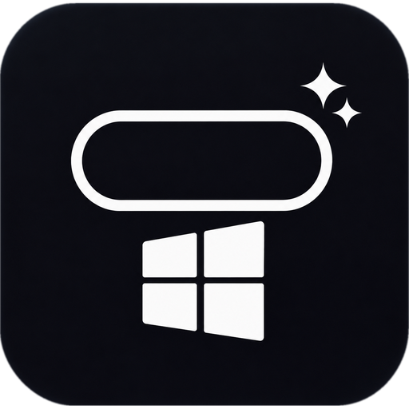

<h1 align="center">Nook</h1>

A living notch (or iOS-style Dynamic Island) for Windows 11. A small pill at the top of your screen that opens on hover into a compact dashboard.

**Download:** grab `nook.exe` from the [latest release](../../releases/latest) and double-click it. No installer, no admin rights.

## What it does

- **Music**: now playing from any app or browser tab, synced lyrics (LRCLIB + NetEase, plain-text fallback), cover art lookup when a browser only gives its own logo, click the artwork to switch between sources.
- **Three styles** (Settings, Appearance, Style): *Notch*, *Floating*, and **Island**, an iOS-style Dynamic Island with springy morphing and a split mode (music pill + timer dot).
- **Pomodoro**: focus / short / long rounds with a round timeline; the running timer also shows in the collapsed pill.
- **Water reminder**: daily goal, bottle size, active hours, hourly chart, reminders.
- **To-do**, **calendar**, **prayer times** (Kemenag RI), **file shelf** with clipboard history, **widgets**.
- **Pop-ups**: volume, Caps Lock, input language, battery, Wi-Fi, Bluetooth.
- Hides only while a game / full-screen video fills the notch's monitor. It never blocks clicks on other apps.

## Updates

Nook updates itself. It checks this repository's latest release in the background (about every 20 minutes), verifies the download (size + SHA-256), and when the notch is idle it swaps in the new version and restarts, with no need to reopen it. Turn it off, or check now, in Settings, General, Updates. If you are on 0.3.0, download the latest release by hand once; after that it is automatic.

## Using it

- Hover the pill to open it. Use the dock at the bottom (or the side arrows, or the mouse wheel) to switch pages.
- Right-click the notch or the tray icon for **Settings** and **Quit**.
- Settings and data live in `%APPDATA%\Nook`.

## Notes

- The exe is not code-signed, so Windows SmartScreen may warn on first run. Choose *More info*, then *Run anyway*.
- Every release ships a `latest.json` with the SHA-256 and size of `nook.exe`; the app checks it before installing an update.
- Requires Windows 10 / 11 (Windows 11 recommended). 64-bit.

Dynamic Island and iPhone are trademarks of Apple Inc. Nook is an independent project and is not affiliated with Apple or with any other notch app.
